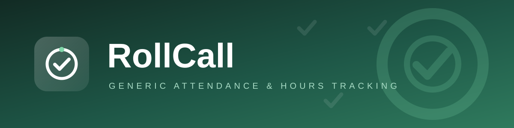
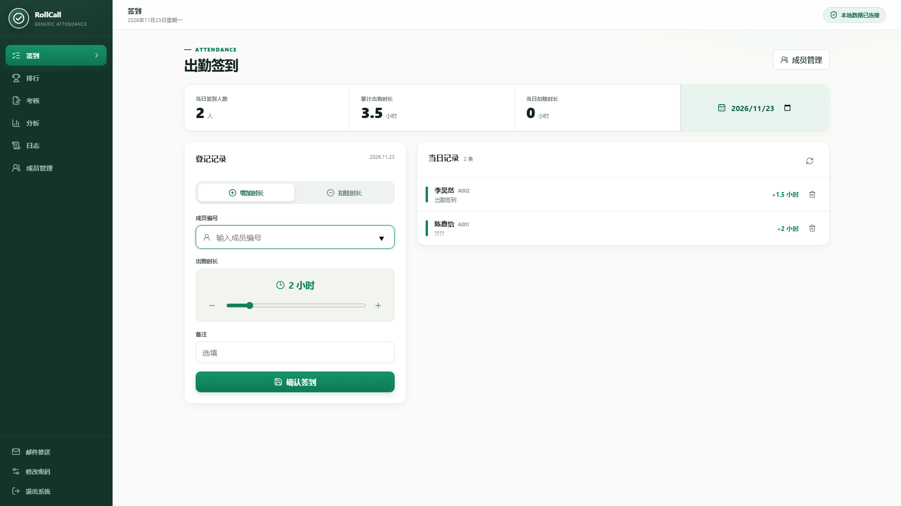
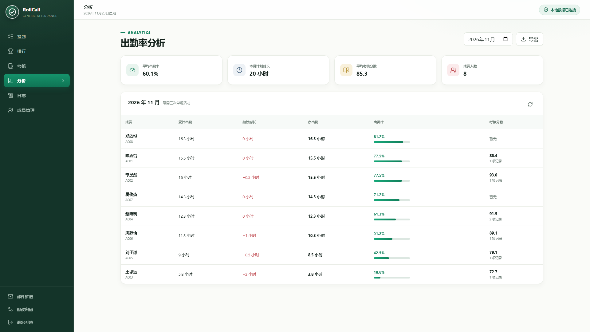
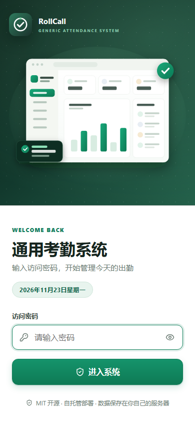
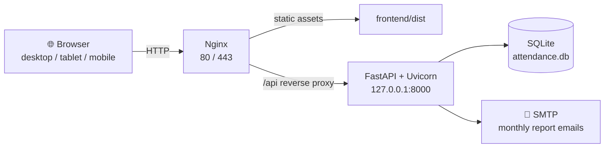

<a id="readme-top"></a>

<div align="center">



<br>

**Check-in · Hours ranking · Assessments · Violation deductions · Analytics · Email digests**

An open-source attendance system for clubs, student organizations, volunteer corps, sports teams and any kind of team

<br><br>


[简体中文](README.md) · **English**

</div>

<br>

> [!NOTE]
> RollCall organizes everything around **hours attended**: log each session per person, auto-accumulate totals and rankings, measure attendance rate against a monthly plan, then layer on assessment scores, violation deductions, CSV reports and monthly email digests — one system for all your attendance chores.

<p align="center">
<b>🎯 Perfect for</b>&nbsp; student orgs &nbsp;·&nbsp; clubs &nbsp;·&nbsp; volunteer corps &nbsp;·&nbsp; sports teams &nbsp;·&nbsp; hobby groups &nbsp;·&nbsp; small teams
</p>

<br>

<div align="center">

[✨ Why](#-why-rollcall) ·
[📋 Features](#-features) ·
[📸 Screenshots](#-screenshots) ·
[🚀 Quick start](#-quick-start) ·
[🌐 Deploy](#-deploy-to-a-server) ·
[📧 Email digests](#-email-digests) ·
[🏗️ Architecture](#-architecture) ·
[❓ FAQ](#-faq) ·
[🤝 Contributing](#-contributing)

</div>

<br>

<p align="center">
  
</p>

---

## ✨ Why RollCall

<table>
<tr>
<td align="center" width="25%" valign="top"><b>🧩 Zero setup</b><br><sub>One-click start<br>No database server</sub></td>
<td align="center" width="25%" valign="top"><b>🕒 Hours-first</b><br><sub>Credit / deduct / rank<br>Auto attendance rate</sub></td>
<td align="center" width="25%" valign="top"><b>🔒 Your data</b><br><sub>Self-hosted<br>Works on intranets</sub></td>
<td align="center" width="25%" valign="top"><b>📱 Responsive</b><br><sub>Desktop / tablet / mobile<br>Any mobile browser</sub></td>
</tr>
</table>

<br>

| | Paper / Excel | Cloud attendance SaaS | **✅ RollCall** |
|:---|:---:|:---:|:---:|
| Cost | Free | Per user / month | ✅ Free & open source |
| Hosting | — | Vendor-bound | ✅ Self-hosted / intranet |
| Hours totals & ranking | Manual | Limited | ✅ Built-in |
| Assessments + deductions | Manual | Rarely | ✅ Built-in |
| Email digests | Manual | ✅ | ✅ |
| Data ownership | Yours | Vendor | ✅ Fully yours |

---

## 📋 Features

<table>
<tr>
<td width="50%"><b>📋 Attendance</b><br><sub>Log hours per person with credit / deduction modes, daily summary and records by date</sub></td>
<td width="50%"><b>🏆 Hours ranking</b><br><sub>Leaderboard of net hours, all-time or monthly view, medals for the top three</sub></td>
</tr>
<tr>
<td width="50%"><b>📝 Assessments</b><br><sub>Exam scores with exam name, item and score, with automatic averages</sub></td>
<td width="50%"><b>⚠️ Violations</b><br><sub>Misconduct records that automatically deduct hours from rankings and rates</sub></td>
</tr>
<tr>
<td width="50%"><b>📊 Analytics</b><br><sub>Monthly attendance rate and average scores, progress bars, one-click CSV export</sub></td>
<td width="50%"><b>📜 Operation logs</b><br><sub>Every add/delete recorded with timestamp, detail and operator IP, filterable by category</sub></td>
</tr>
<tr>
<td width="50%"><b>👥 Members</b><br><sub>Roster, cohort grouping, email maintenance, enable / disable</sub></td>
<td width="50%"><b>📧 Email digests</b><br><sub>Scheduled or one-click personal monthly reports, scoped by cohort or selection</sub></td>
</tr>
</table>

---

## 📸 Screenshots

#### 📋 Attendance

Log hours per person with a live daily summary.

<p align="center">
  
</p>

<table>
<tr>
<td align="center"><br><sub><b>🏆 Hours ranking</b></sub></td>
<td align="center"><br><sub><b>📝 Assessments & violations</b></sub></td>
</tr>
</table>

#### 📊 Analytics

Monthly attendance rate and scores with CSV export.

<p align="center">
  
</p>

<details>
<summary><b>📱 Mobile UI</b> (click to expand)</summary>

<br>

<table>
<tr>
<td align="center"><br><sub>Mobile · Attendance</sub></td>
<td align="center"><br><sub>Mobile · Analytics</sub></td>
<td align="center"><br><sub>Mobile · Login</sub></td>
</tr>
</table>

</details>

---

## 🚀 Quick Start

**Requirements**: Python 3.10+ and Node.js 18+.

On Windows, double-click `start.bat` or run:

```powershell
.\start.ps1
```

Dependencies are installed automatically on first run. Then open:

| URL | What it is |
|:---|:---|
| http://127.0.0.1:5173 | Web UI |
| http://127.0.0.1:8000/docs | Backend API docs (Swagger) |

Press <kbd>Ctrl</kbd> + <kbd>C</kbd> to stop both services.

> [!IMPORTANT]
> The initial access password is `2006`. Change it immediately after the first login via **Change password** in the sidebar.

> [!TIP]
> By default only the local machine can access the app. Want it on **phones, tablets or other computers**? See [🌐 Deploy to a Server](#-deploy-to-a-server) below.

<details>
<summary><b>Manual start</b> (without the start scripts)</summary>

```bash
# Backend
cd backend
pip install -r requirements.txt
python -m uvicorn app.main:app --host 127.0.0.1 --port 8000

# Frontend (separate terminal)
cd frontend
npm install
npm run dev
```

</details>

<details>
<summary><b>Demo data</b> (fictional data to try the UI)</summary>

```bash
cd backend
python seed_demo.py          # seed an empty database
python seed_demo.py --force  # wipe and re-seed
```

> [!WARNING]
> `--force` wipes existing members and all records. Never run it on production data.

</details>

---

## 🌐 Deploy to a Server

Deploy RollCall to a server and phones, tablets and other computers can all reach it through a browser — no need to keep your own machine running.

### Option 1: LAN trial (2 minutes)

Great for on-site use with teammates on the same Wi-Fi. After starting `start.bat` / `start.ps1`, the frontend already listens on all network interfaces — other devices just open:

```text
http://<your-machine-LAN-IP>:5173
```

Find your LAN IP with `ipconfig` (Windows) or `ip addr` (Linux/macOS). Allow the port through your firewall when prompted (Windows shows an approval dialog).

> [!NOTE]
> LAN mode requires your machine to stay on and is only reachable within the same network — fine for temporary use during training or events.

### Option 2: Cloud server (recommended · long-term)

Deploy once, access anywhere. Architecture: **Nginx (80/443) → FastAPI (127.0.0.1:8000) → SQLite**.

| Step | Action |
|:---:|:---|
| 1️⃣ Build frontend | `npm --prefix frontend ci && npm --prefix frontend run build` → `frontend/dist` |
| 2️⃣ Upload code | Copy `backend/` and `frontend/dist` to the server (e.g. `/opt/rollcall/`) |
| 3️⃣ Run backend | systemd keeps uvicorn alive: auto-start on boot, auto-restart on crash |
| 4️⃣ Reverse proxy | Nginx serves the static pages and forwards `/api` to the backend |
| 5️⃣ Public access | Open ports 80/443; bind a domain + Certbot for HTTPS |
| 6️⃣ Mobile access | Open your domain/IP in any phone browser; "Add to Home Screen" for an app-like feel |

> [!TIP]
> The frontend calls the backend through **relative** `/api` paths — behind Nginx everything is same-origin, so **no API URL or configuration changes are needed**.

Full step-by-step commands, `systemd` / `Nginx` config templates, daily backups and hardening: **[docs/DEPLOYMENT.md](docs/DEPLOYMENT.md)** (Chinese).

### Moving local data to the server

Copy your local `backend/data/attendance.db` to the same path on the server (or point `ATTENDANCE_DB_PATH` at it) to keep every record:

```bash
scp backend/data/attendance.db user@your-server-ip:/opt/rollcall/backend/data/
```

> [!WARNING]
> Stop the service before copying the database. If it must stay running, use the SQLite `.backup` command or copy the `-wal` / `-shm` files too.

---

## 📧 Email Digests

Every member with an email address receives a **personal monthly report** — hours for the month, cumulative totals, violations, exam scores and next month's plan.

1. Fill in emails under **Members**
2. Open **Email reports** → **SMTP settings** in the sidebar (e.g. `smtp.qq.com:465` + authorization code), send a test email first
3. The **Send** tab picks a month and scope (everyone / cohort / selected members)
4. The **History** tab shows every delivery result; auto-send on the last day of each month is optional

> [!TIP]
> The sender name (the report's signature) is configurable in SMTP settings — no code change needed.

---

## 🏗️ Architecture



| Layer | Tech |
|:---|:---|
| Frontend |   Lucide Icons |
| Backend |  Uvicorn |
| Database |  local file (WAL mode) |
| Auth | PBKDF2-SHA256 + session tokens |

Production deployment (Nginx + systemd + backups + HTTPS): **[docs/DEPLOYMENT.md](docs/DEPLOYMENT.md)** (Chinese).

---

## 🛠️ Configuration

| Setting | Default | Description |
|:---|:---|:---|
| `ATTENDANCE_DB_PATH` | `backend/data/attendance.db` | Database file path (env variable) |
| Access password | `2006` | Change it in the UI after first login |
| Frontend port | `5173` | Vite dev server |
| Backend port | `8000` | FastAPI / Uvicorn |

<details>
<summary><b>💾 Backup</b></summary>

<br>

Data lives in `backend/data/attendance.db`. Stop the service and copy the file to back up.

> [!WARNING]
> While running, use the SQLite `.backup` command or copy the `-wal` and `-shm` files together with the database, or recent writes may be lost.

```bash
sqlite3 backend/data/attendance.db ".backup backup-$(date +%F).db"
```

</details>

---

## 🎨 Rebranding

1. Replace `frontend/public/assets/logo.svg` with your own logo
2. Search and replace `RollCall` in `frontend/src/App.jsx` and `frontend/index.html`
3. The email sender name is configurable in **Email reports → SMTP settings**

---

## 🗺️ Roadmap

- [x] Attendance / ranking / assessments / violations / analytics / logs
- [x] Email digests (manual + monthly auto-send)
- [x] Cohort grouping and scoped sending
- [ ] Multi-user roles and permissions
- [ ] One-click Docker deployment
- [ ] UI internationalization (i18n)
- [ ] Richer data import / export

Feature requests welcome in the Issues.

---

## ⭐ Star History

<p align="center">
  <a href="https://star-history.com/#SuperPatrick06/RollCall&Date">
    
  </a>
</p>

If RollCall helps you, please give it a ⭐ Star so more people can find it!

---

## ❓ FAQ

<details>
<summary><b>What is the default password?</b></summary>

<br>

`2006` — change it via **Change password** in the sidebar after logging in. Passwords are stored as salted PBKDF2-SHA256 hashes.

</details>

<details>
<summary><b>Does it need internet or payment?</b></summary>

<br>

No. It is completely free and works offline — everything is stored in a local SQLite file and runs fine on intranets. Only the email feature needs access to your SMTP server.

</details>

<details>
<summary><b>Can I use it on a phone?</b></summary>

<br>

Yes — the UI is fully adapted for phones (bottom navigation bar). Deploy it to a server (see [docs/DEPLOYMENT.md](docs/DEPLOYMENT.md)) and open it in any mobile browser.

</details>

<details>
<summary><b>Where is my data and is it safe?</b></summary>

<br>

In `backend/data/attendance.db`, easy to copy and back up. Authentication is a shared access password plus session tokens — a simple model that fits small teams; per-user roles are on the roadmap.

</details>

---

## 🤝 Contributing

Issues and pull requests are welcome! For larger changes, please open an issue first to discuss the approach.

```bash
# Dev checks
cd backend && python -m pytest        # backend tests
cd frontend && npm run build          # frontend build
cd frontend && npm run visual-check   # visual check (generates screenshots)
```

---

## 📄 License

Released under the [MIT License](LICENSE).

<div align="center">

**If this project helps you, please give it a ⭐ Star**

<br>

<sub>📖 <a href="README.md">中文文档</a> &nbsp;·&nbsp; 🚀 <a href="docs/DEPLOYMENT.md">Deployment Guide</a> &nbsp;·&nbsp; 📄 <a href="LICENSE">MIT License</a></sub>

<br><br>

<a href="#readme-top">Back to top ⬆</a>

</div>
