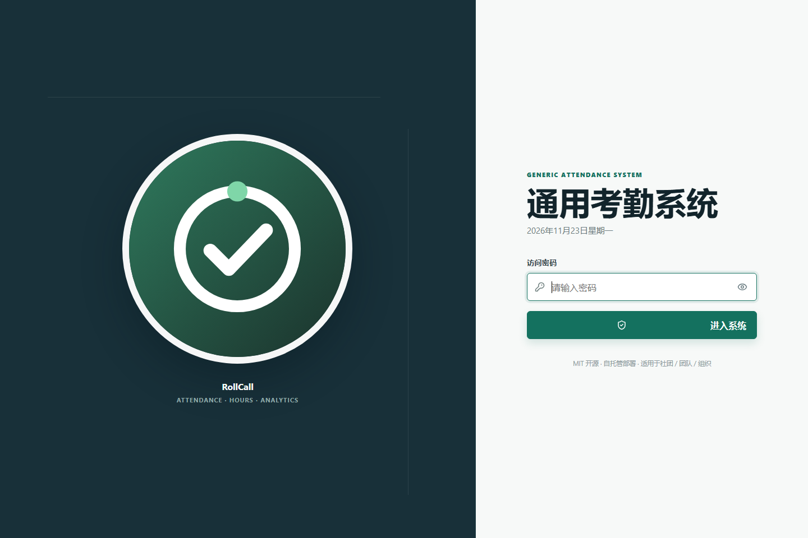
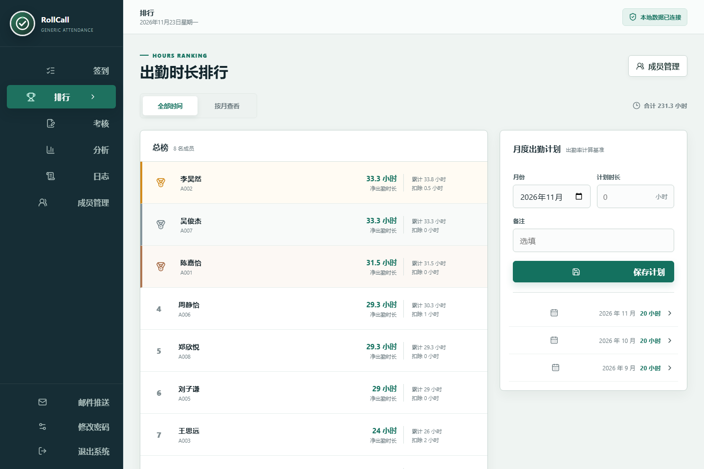
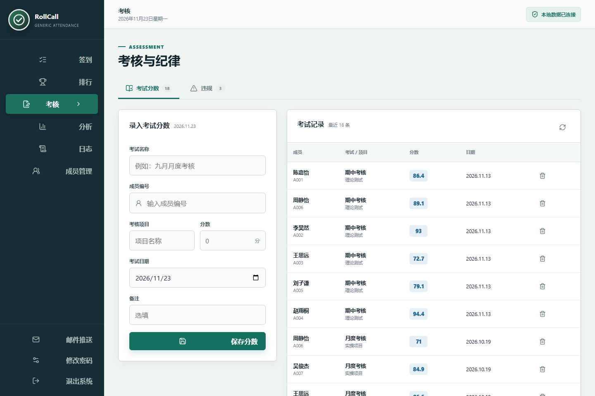

<div align="center">

# RollCall · 点名册

**Generic Attendance & Hours Tracking**

For clubs, student organizations, volunteer corps, sports teams and any kind of team

<br>


English · [简体中文](README.md)

</div>

---

## About

RollCall is an open-source, self-hosted attendance system organized around **hours attended**: log each session per person, auto-accumulate totals and rankings, measure attendance rate against a monthly plan, and keep assessment scores, violation deductions, CSV reports and monthly email digests — all in one place.

- 🧩 **Zero setup** — one-click start scripts, data stored in a local SQLite file, no database server needed
- 📱 **Responsive** — desktop / tablet / mobile layouts
- 🔒 **Simple auth** — a shared access password plus session tokens (PBKDF2-SHA256)
- 📧 **Email digests** — scheduled or one-click personal monthly reports
- 🪪 **White-label friendly** — neutral placeholder logo, easy to rebrand



---

## Features

| Module | Description |
|:---|:---|
| 📋 Attendance | Log hours per person with credit / deduction modes, filter by date |
| 🏆 Hours ranking | Leaderboard of net hours, monthly view, monthly plan targets |
| 📝 Assessments | Exam scores with exam name, item and score |
| ⚠️ Violations | Misconduct records that automatically deduct hours |
| 📊 Analytics | Monthly attendance rate & average scores, CSV export |
| 📜 Operation logs | Every add/delete with timestamp, detail and operator IP |
| 👥 Members | Roster, cohort grouping, email maintenance, enable/disable |
| 📧 Email reports | Scheduled or one-click personal monthly digests |

---

## Screenshots

| Attendance | Ranking |
|:---:|:---:|
|  |  |

| Assessments | Analytics |
|:---:|:---:|
|  |  |

---

## Quick Start

Requirements: **Python 3.10+**, **Node.js 18+**.

On Windows, double-click `start.bat` or run:

```powershell
.\start.ps1
```

Dependencies are installed automatically on first run. Then open:

| URL | What it is |
|:---|:---|
| http://127.0.0.1:5173 | Web UI |
| http://127.0.0.1:8000/docs | Backend API docs (Swagger) |

Press `Ctrl+C` to stop both services.

> 🔑 The initial access password is `2006` — change it right after the first login.

Manual start:

```bash
# Backend
cd backend
pip install -r requirements.txt
python -m uvicorn app.main:app --host 127.0.0.1 --port 8000

# Frontend (separate terminal)
cd frontend
npm install
npm run dev
```

### Demo data

To try the UI with fictional data:

```bash
cd backend
python seed_demo.py          # seed an empty database
python seed_demo.py --force  # wipe and re-seed
```

---

## Email Reports

Each member with an email address receives a **personal monthly report** with hours for the month, cumulative totals, violations, exam scores and next month's plan.

- Fill in emails under **Members**
- Open **Email reports** in the sidebar, configure SMTP (e.g. `smtp.qq.com:465` + authorization code), send a test email first
- The **Send** tab picks a month and a target scope (everyone / cohort / selected members); optional auto-send on the last day of each month
- The **History** tab shows every delivery result

> ⚠️ Scheduled sending only runs while the app is running.

---

## Data & Backup

Data lives in `backend/data/attendance.db` (override with the `ATTENDANCE_DB_PATH` environment variable). Stop the service and copy the file to back up.

> ⚠️ While running, use the SQLite `.backup` command, or copy the `-wal` and `-shm` files together with the database.

---

## Production Deployment

A full Nginx + systemd deployment guide (backups, HTTPS, hardening) is in [docs/DEPLOYMENT.md](docs/DEPLOYMENT.md) (Chinese).

---

## Rebranding

1. Replace `frontend/public/assets/logo.svg` with your own logo
2. Search and replace `RollCall` in `frontend/src/App.jsx` and `frontend/index.html`
3. The email sender name is configurable in **Email reports → SMTP settings** — no code change needed

---

## Tech Stack

| Layer | Tech |
|:---|:---|
| Frontend | React + Vite + Lucide Icons |
| Backend | FastAPI + Uvicorn |
| Database | SQLite (local file) |
| Auth | PBKDF2-SHA256 + session tokens |

---

## Development

```bash
# Backend tests
cd backend
pip install -r requirements-dev.txt
python -m pytest

# Frontend build
cd frontend
npm run build

# Visual check (uses local Chrome, writes screenshots to docs/images)
npm run visual-check
```

---

## License

Released under the [MIT License](LICENSE).

Issues and pull requests are welcome.
