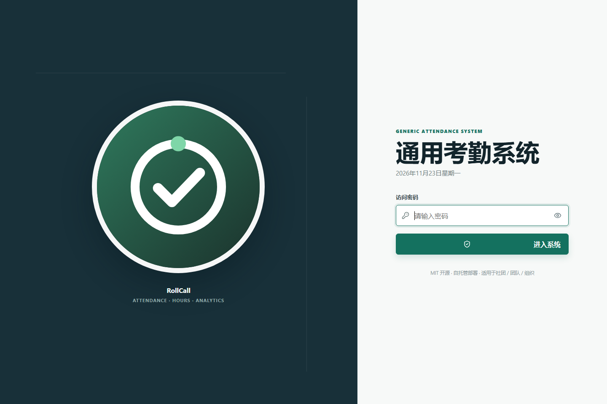
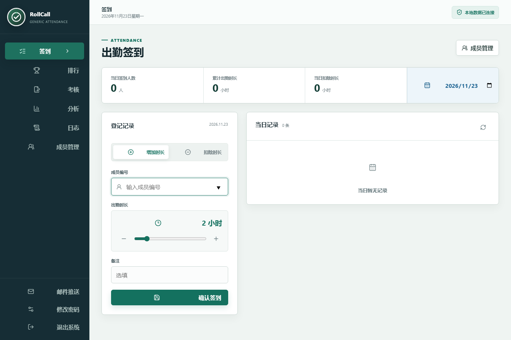
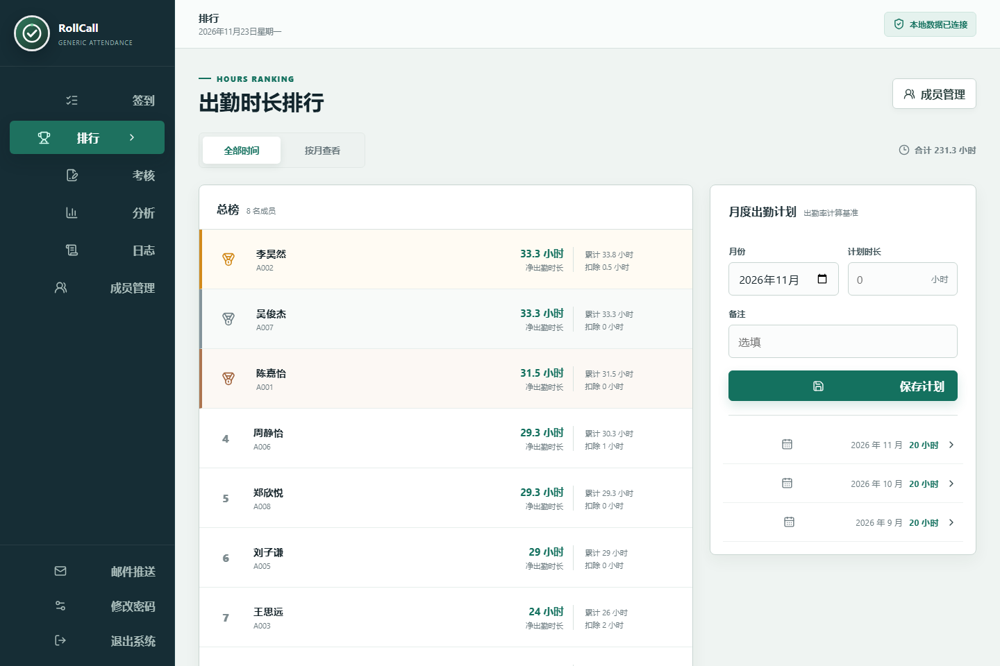
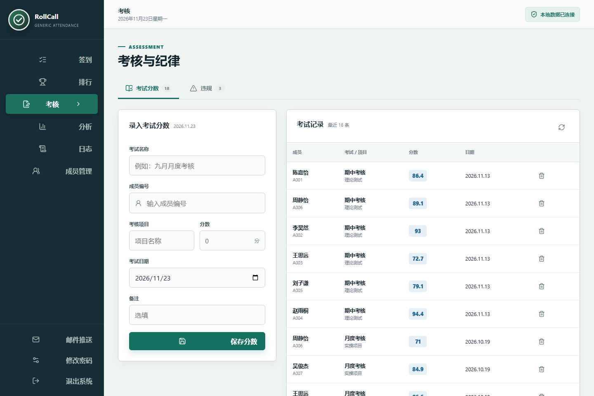
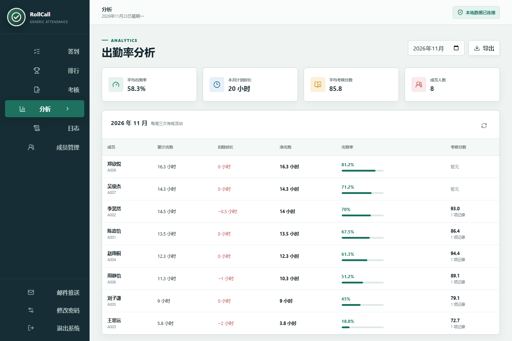
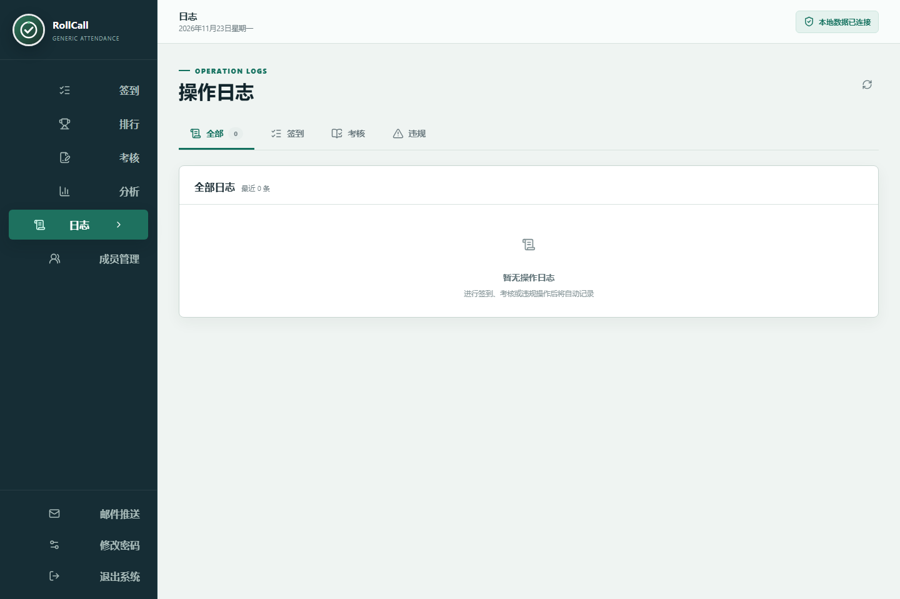
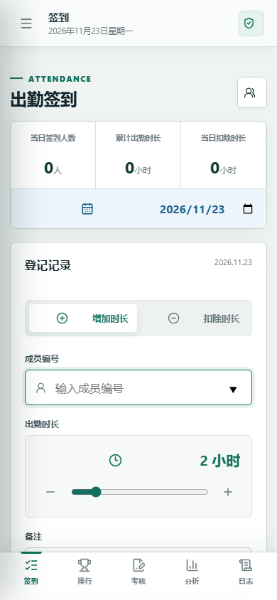
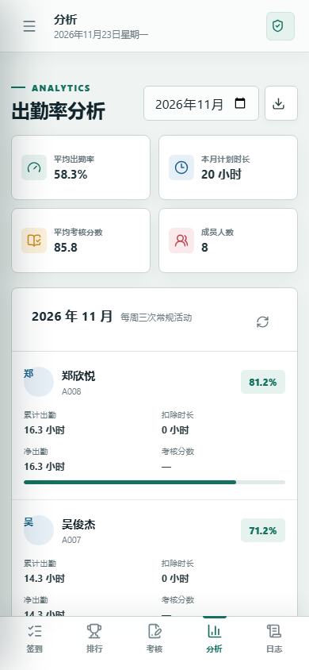

<div align="center">

# RollCall · 点名册

**通用考勤与出勤时长管理系统 · Generic Attendance & Hours Tracking**

适用于社团、学生组织、志愿队、运动队与各类团队

<br>


[English](README.en.md) · 简体中文

</div>

---

## 简介

RollCall 是一个开源、可自托管的考勤系统。它围绕**出勤时长**来组织数据：逐人登记每次活动的时长，自动累计与排行，结合月度计划计算出勤率，支持考核成绩、违规扣时、CSV 报表与邮件月报。

- 🧩 **开箱即用** — 一键启动脚本，数据保存在本地 SQLite，无需额外部署数据库
- 📱 **多端适配** — 桌面 / 平板 / 手机自适应布局
- 🔒 **简单认证** — 共享访问密码 + 会话 Token（PBKDF2-SHA256）
- 📧 **邮件月报** — 定时或一键向成员推送个人月度报告
- 🪪 **品牌可替换** — 内置中性占位 Logo，可轻松换成自己组织的标识



---

## 功能模块

| 模块 | 说明 |
|:---|:---|
| 📋 出勤签到 | 逐人登记活动时长，支持增加 / 扣除，按日期查看统计 |
| 🏆 时长排行 | 全员出勤时长排行榜，支持按月查看与月度计划设置 |
| 📝 考核 | 考试分数录入，记录考试名称、考核项目与成绩 |
| ⚠️ 违规 | 违规记录录入，记录违规行为并自动扣除出勤时长 |
| 📊 出勤分析 | 按月统计出勤率与考核分数，支持导出 CSV 报表 |
| 📜 操作日志 | 自动记录增删操作，按类别筛选，含操作时间与 IP |
| 👥 成员管理 | 成员名册、届别分组、邮箱维护、停用与恢复 |
| 📧 邮件推送 | 定时或一键向成员发送个人月度报告 |

---

## 邮件推送

向每位填写了邮箱的成员发送**当月个人月度报告**，内容包含当月出勤时长、累计出勤总时长、违规情况、考核分数及下月计划安排。

- 在**成员管理**中为成员填写邮箱地址
- 打开侧边栏「**邮件推送**」，在 **SMTP 设置** 中填写发信邮箱（如 QQ 邮箱 `smtp.qq.com:465` + 授权码），可先发送测试邮件验证
- **发送报告** 标签页可选择月份与推送范围（全员 / 按届别 / 指定成员），一键推送；也可勾选「每月最后一天自动推送」
- **发送记录** 标签页查看每次发送的结果

> ⚠️ 自动推送仅在本程序运行期间生效，关闭后不会发送。

---

## 功能截图

### 📋 出勤签到

逐人登记每日出勤时长，支持增加和扣除两种模式。日期自由切换，实时统计当日签到人数、累计出勤时长、扣除时长。



### 🏆 时长排行

全员出勤时长排行榜，自动计算净出勤时长。支持全部时间与按月查看，可设置月度计划作为出勤率基准。



### 📝 考核与违规

考试分数与违规记录录入，违规自动计入扣时。



### 📊 出勤分析

按月统计每位成员的出勤率与平均考核分数，可视化进度条展示完成度，支持一键导出 CSV 报表。



### 📜 操作日志

自动记录所有数据的新增与删除操作，按签到 / 考核 / 违规分类筛选。每条记录包含操作时间、详情及操作人 IP 地址。



---

## 快速开始

环境要求：**Python 3.10+**、**Node.js 18+**。

双击 `start.bat`，或在 PowerShell 中运行：

```powershell
.\start.ps1
```

首次启动会自动安装依赖。启动后浏览器访问：

| 地址 | 说明 |
|:---|:---|
| http://127.0.0.1:5173 | 前端页面 |
| http://127.0.0.1:8000/docs | 后端接口文档（Swagger） |

按 `Ctrl+C` 停止服务。

> 🔑 初始访问密码 `2006`，进入系统后请立即在「修改密码」中更换。

也可以手动启动：

```bash
# 后端
cd backend
pip install -r requirements.txt
python -m uvicorn app.main:app --host 127.0.0.1 --port 8000

# 前端（另开一个终端）
cd frontend
npm install
npm run dev
```

### 演示数据

想先体验效果，可以在后端目录一键填充虚构的演示数据：

```bash
cd backend
python seed_demo.py          # 空库时写入演示数据
python seed_demo.py --force  # 清空后重新生成
```

---

## 多端适配

- **桌面端** — 左侧导航栏，双栏布局
- **平板端** — 自适应卡片排列
- **手机端** — 底部导航栏，全屏适配

| 移动端签到 | 移动端分析 |
|:---:|:---:|
|  |  |

---

## 数据备份

数据保存在 `backend/data/attendance.db`（可用环境变量 `ATTENDANCE_DB_PATH` 自定义路径），停止服务后复制该文件即可完成备份。

> ⚠️ 运行期间如需备份，请使用 SQLite `.backup` 命令，或同时保留同目录的 `-wal` 和 `-shm` 文件。

---

## 生产部署

Nginx + systemd 的完整部署步骤（含备份、HTTPS、安全建议）见 [docs/DEPLOYMENT.md](docs/DEPLOYMENT.md)。

---

## 自定义品牌

项目内置中性占位 Logo 与「RollCall」品牌文案，替换为你自己的组织标识：

1. 用你的 Logo 覆盖 `frontend/public/assets/logo.svg`（任意 SVG/PNG，若用 PNG 请同步修改引用路径）
2. 全局搜索 `RollCall` 替换为你自己的名称（主要在 `frontend/src/App.jsx`、`frontend/index.html`）
3. 邮件发件人名称可在「邮件推送 → SMTP 设置」中修改，无需改代码

---

## 技术栈

| 层级 | 技术 |
|:---|:---|
| 前端 | React + Vite + Lucide Icons |
| 后端 | FastAPI + Uvicorn |
| 数据库 | SQLite（本地存储） |
| 认证 | PBKDF2-SHA256 + 会话 Token |

---

## 项目结构

```
RollCall/
├── backend/
│   ├── app/            # 接口、认证、数据模型、邮件服务
│   ├── tests/          # 业务流程测试
│   ├── seed_demo.py    # 演示数据生成脚本
│   └── data/           # 数据库文件（不入库）
├── frontend/
│   ├── src/            # 页面与样式
│   ├── public/         # 静态资源（Logo 等）
│   └── scripts/        # 视觉检查 / 截图脚本
├── docs/               # 部署指南与 README 截图
├── start.bat           # Windows 一键启动
└── start.ps1           # PowerShell 启动脚本
```

---

## 开发与测试

```bash
# 后端测试
cd backend
pip install -r requirements-dev.txt
python -m pytest

# 前端构建
cd frontend
npm run build

# 视觉检查（需要本机 Chrome，自动截图到 docs/images）
npm run visual-check
```

---

## 开源许可

本项目基于 [MIT 协议](LICENSE) 开源。

欢迎 Issue 和 Pull Request。
